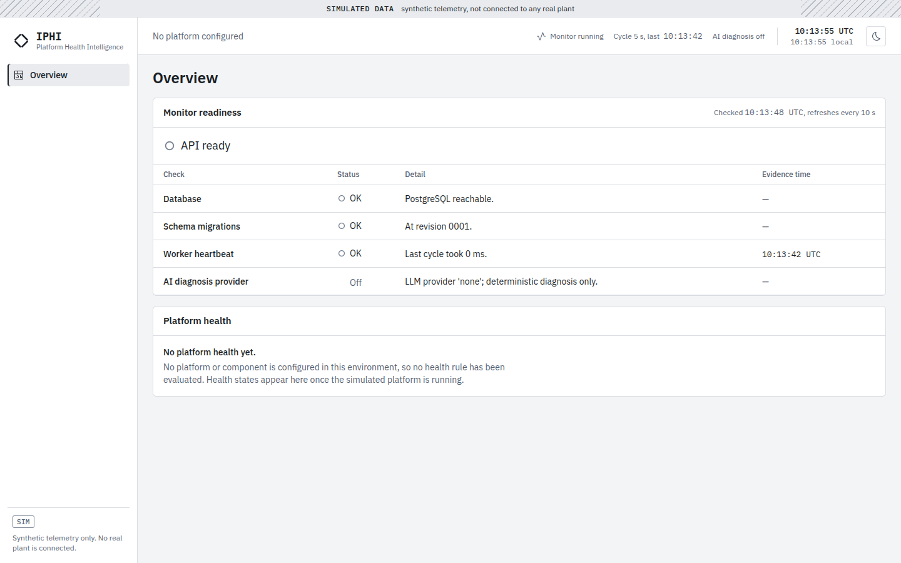

# IPHI — Industrial Platform Health Intelligence

IPHI monitors the health of an **industrial data platform** — sources, gateway, collector, historian, database, API — rather than the machines it measures. It ingests metrics and logs, computes explainable health states (`Healthy`, `Warning`, `Critical`, `Unknown`), opens deduplicated incidents backed by stored evidence, and can add an evidence-grounded diagnosis.

> **Simulated data.** IPHI runs against a simulated infrastructure. It is not connected to any real plant, PLC or historian, claims no compatibility with any commercial product (AVEVA PI included), and is not production software. Every simulated observation is labelled as such in the UI, the API and exports.

## Status

| Story | Scope | State |
|---|---|---|
| US-01 | One-command stack, migrations, readiness, CI, app shell | Delivered |
| US-02 | Seven-component simulated platform, deterministic generator, nine scenarios, platform clock | Delivered (API only) |
| US-03 | Validated ingestion, PostgreSQL history, metric and log APIs, collection monitoring | Delivered (API only) |
| US-04 | Versioned health rules, hysteresis, `Unknown`, component and platform health with justification | Delivered (API only) |
| US-05 | Deduplicated incidents with evidence, lifecycle, downstream suppression, deterministic diagnosis | Delivered (API only) |
| US-06 → US-12 | Dashboard, live updates, AI diagnosis, reports, security | Planned ([backlog](docs/03-backlog.md)) |

What runs today: PostgreSQL, a migration and seed job, the FastAPI API (`/health`, `/ready`, simulation, metrics, logs, health and system status endpoints, OpenAPI), a worker that holds the scheduler lock and, every cycle, collects the simulated observations, validates and stores them, evaluates the health rules, opens, updates and resolves incidents, purges data past retention and writes a heartbeat, and the frontend shell showing monitor readiness. Health and incident screens arrive with US-06.



## Requirements

- Docker Engine with the Compose plugin (v2 or later)
- For local development outside containers: [uv](https://docs.astral.sh/uv/) ≥ 0.13, Node.js ≥ 24, pnpm 12, GNU Make

## Run

```sh
docker compose up --build        # or: make up
```

| Service | Address | Role |
|---|---|---|
| frontend | http://127.0.0.1:8080 | Static build behind Nginx; proxies `/api`, `/health`, `/ready` |
| api | http://127.0.0.1:8000/docs | FastAPI, OpenAPI at `/api/v1/openapi.json` |
| db | 127.0.0.1:5433 | PostgreSQL 16 |
| migrate | — | `alembic upgrade head`, idempotent seed (topology, clock, baseline run), then exits |
| worker | — | Single scheduler (PostgreSQL advisory lock), heartbeat every 5 s |

All ports bind to `127.0.0.1` (`IPHI_BIND_HOST` moves the API and frontend; the database stays local). Defaults work without configuration; copy `.env.example` to `.env` to change ports or the local database password.

Check the stack:

```sh
curl -i http://127.0.0.1:8000/health   # 200 {"status":"ok"}
curl -i http://127.0.0.1:8000/ready    # 200 once migrated and the worker has cycled, 503 otherwise
```

`/ready` reports four checks: database reachable, schema at the code's migration head, worker heartbeat younger than three cycles, AI provider (`disabled` until US-08). Stop the worker (`docker compose stop worker`) and the readiness turns `503`, and the top bar shows *Monitor stalled*: the monitor never looks healthy while blind.

## Simulation

The simulated platform (`sim-plant-01`) has seven components — `plc-sim-01 → edge-gateway-01 → collector-01 → historian-01 (+ timeseries-db-01) → data-api-01 → analytics-01` — each probed every 5 s of **platform time** (`up`, `probe_latency_ms`, plus load, queue, data age and error metrics depending on its type). Values are a pure function of seed, component, metric, sample slot and the scenario runs covering it: the same inputs give the same observations, in any order and after any restart.

| Scenario | Default target | Expected outcome (default rules) |
|---|---|---|
| `baseline` | all | Healthy everywhere; always running |
| `collector_down` | collector-01 | Critical, downstream impacted, one availability incident |
| `latency_rise` | edge-gateway-01 | Warning then Critical, one latency incident |
| `stale_data` | historian-01 | Service up, data ageing, one freshness incident |
| `intermittent_loss` | edge-gateway-01 | Isolated probe failures, one connectivity incident |
| `error_burst` | data-api-01 | Repeated errors, one incident with growing occurrences |
| `resource_pressure` | timeseries-db-01 | CPU and memory above 90 %, one resources incident |
| `backlog_growth` | collector-01 | Growing queue, one backlog incident |
| `telemetry_blackout` | historian-01 | No observation at all, Unknown, one telemetry-loss incident |

```sh
B=http://127.0.0.1:8080/api/v1/simulations
curl -s $B/scenarios                                   # catalog, parameters, expected outcomes
curl -s -X POST $B/scenarios -H 'content-type: application/json' \
     -d '{"scenario_key": "latency_rise", "parameters": {"peak_ms": 2000}, "duration_s": 600}'
curl -s "$B/runs?status=active"                        # runs, newest first (cursor pagination)
curl -s -X POST $B/clock -H 'content-type: application/json' \
     -d '{"action": "set_mode", "mode": "accelerated", "speed": 10}'   # realtime | accelerated | manual
curl -s -X POST $B/reset -H 'content-type: application/json'   # stop runs, realtime clock, fresh baseline
```

Mutations (start, stop, clock, reset) are unauthenticated until US-11: they work only with `IPHI_DEV_MUTATIONS=true` (the Compose default) **and** ports published on loopback; otherwise they answer `403 MUTATIONS_DISABLED`. They also require `Content-Type: application/json` (even without a body) and refuse cross-site browser requests, so another web page cannot trigger them; the API only answers the `Host` names in `IPHI_ALLOWED_HOSTS`. Every attempt is written to the append-only audit log.

Preview the generator without a database; the printed fingerprint is the one checked by the golden test:

```sh
cd backend && uv run python -m scripts.simulate collector_down --ticks 120
# fingerprint df67ef15df8ffe50249e2e5d18982eeefc027c3fff9ae90584c7faf134152cbc
```

## Observations

Every cycle the worker collects each elapsed 5 s sample slot once (also in accelerated time), validates it and stores it in PostgreSQL, with `observed_at` (event time) and `received_at` (ingestion time), `source=simulation` and the scenario run that shaped it. Invalid observations are rejected and counted per code (unknown component or metric, wrong unit, out of range, more than 30 s in the future, more than 10 min late, oversized log); re-delivered ones are ignored and counted. A failing connector is recorded as a failed collection run without stopping the cycle. Observations older than `IPHI_RETENTION_DAYS` (7) are purged; `reset` purges the simulated history.

```sh
A=http://127.0.0.1:8080/api/v1
curl -s $A/system/status            # clock, worker cycle, collection state and recent runs
curl -s $A/metrics/catalog          # metric names, units, accepted ranges
C=$(docker compose exec -T db psql -U iphi -Atc "SELECT id FROM component WHERE key='collector-01'")
curl -s "$A/metrics?component_id=$C&metric_name=probe_latency_ms&max_points=200"
curl -s "$A/logs?component_id=$C&min_severity=warning&limit=20"
```

`GET /metrics` returns raw samples while the window holds at most `max_points` (≤ 2000), otherwise min/avg/max buckets; windows are limited to 7 days, and stretches without data come back as explicit `gaps`, never interpolated. Component IDs are listed by `GET /components`.

## Health

Nine default rules in [`backend/config/health_rules.yaml`](backend/config/health_rules.yaml) (availability, connectivity ratio, p95 latency, process-data freshness, errors, CPU, memory, backlog, telemetry loss) are evaluated at every 5 s sample slot of platform time, so the state history is the same in realtime, accelerated or manual mode. Each rule has warning and critical thresholds with distinct clear thresholds, and needs `raise_after` consecutive evaluations to get worse and `clear_after` to recover: a value oscillating inside the band never changes the state. A rule without samples in its window is `Unknown`, never `Healthy`; a component that stops answering its probe is `Critical`, one IPHI no longer observes at all is `Unknown`.

A component takes the worst state of its rules (`Critical > Unknown > Warning > Healthy`); components downstream of a `Critical` or `Unknown` one are marked as impacted without changing their own state. The platform state follows a priority table, never an average: a high- or medium-criticality component `Critical` makes it `Critical`, a high one `Unknown` makes it `Unknown`, any other degradation `Warning`. Thresholds are demonstration values, not industrial recommendations; changing one in the file creates a new rule version at the next bootstrap.

```sh
curl -s $A/platforms                    # aggregated state, counts, priority line applied
curl -s "$A/components?state=critical"  # current state, deciding evaluation, impacted_by
curl -s $A/components/$C/health         # every rule: threshold, window, value, evidence, debounce
curl -s "$A/rule-evaluations?component_id=$C&rule_key=R-LAT-001"   # stored evaluations
curl -s $A/health-rules                 # active rule versions (read-only)
```

Every state cites its rule version, window, threshold, observed value and the IDs of the samples behind it. If the worker stops evaluating, the API reports `unknown` with `stale: true` instead of the last computed state.

## Incidents

When a rule turns `Warning` or `Critical` (or a component that was observed goes silent), the worker opens an incident, fingerprinted by platform, component and failure class: a database index guarantees at most one active incident per fingerprint, so a persistent fault updates the same incident (occurrences, severity up or down) instead of opening new ones. An incident resolves itself once every rule it covers is back to `Healthy`; the same failure within 15 minutes of platform time reopens it. Losing connectivity on an unreachable component is part of the same incident. Alerts of components downstream of an unreachable or silent one are attached to the upstream incident as impact rather than opening their own.

Every incident links the rule evaluations behind it and the samples and logs they cite; these are kept by retention and by `reset`, which closes active incidents (`resolution: reset`). The timeline (opened, occurrences, severity changes, acknowledgement, resolution, reopening, suppressed downstream alerts, diagnoses) is append-only.

```sh
curl -s "$A/incidents?status=open&status=acknowledged"    # newest first, cursor pagination
I=$(curl -s "$A/incidents?status=open" | python3 -c 'import json,sys; print(json.load(sys.stdin)["items"][0]["id"])')
curl -s $A/incidents/$I                     # covered rules, evidence (E1…En), timeline
curl -s -X POST $A/incidents/$I/ack -H 'content-type: application/json'
curl -s -X POST "$A/incidents/$I/diagnose?mode=deterministic" -H 'content-type: application/json'
curl -s -X POST $A/incidents/$I/resolve -H 'content-type: application/json' \
     -d '{"comment": "Collector restarted."}'   # 409 while the condition is still active
```

The deterministic diagnosis lists observed facts, a hypothesis (the most upstream component in fault, always worded as a correlation) and the checks recommended by the rules involved, each citing its evidence; it needs no AI provider. Acknowledgement, resolution and diagnosis follow the same mutation guard as the simulation and are audited.

## Develop and test

```sh
make install     # uv sync + pnpm install from the lockfiles
make check       # lint, type checks, tests, API client drift — what CI runs
make help        # every target
```

- Backend tests run against a real PostgreSQL (`make test-backend` starts the `db` service; each test gets a fresh database).
- Frontend tests use Vitest, Testing Library and axe-core.
- The TypeScript API types are generated from the backend OpenAPI document (`make api-client`); CI fails if they drift.
- Frontend dev server with hot reload: `cd frontend && pnpm dev` (http://127.0.0.1:5173, proxied to the API on port 8000).

## Repository layout

```text
backend/    FastAPI app (app/), Alembic migrations, tests (unit + PostgreSQL integration)
frontend/   React + TypeScript + Vite, Tailwind tokens from the design system
docs/       Requirements, architecture, backlog, design system, ADRs (French)
```

## Documentation

The design dossier is in French: [requirements](docs/01-cahier-des-charges.md), [architecture](docs/02-architecture-technique.md), [backlog](docs/03-backlog.md), [design system](docs/04-design-system.md), [decision records](docs/adr/README.md). Engineering rules: [rules.md](rules.md).

## Limitations

- There is no health, incident, Scenarios or metrics screen before US-06; comments on incidents arrive with US-07, the AI diagnosis with US-08.
- Downstream suppression can hide a second, independent fault downstream: its evidence stays attached to the upstream incident as impact.
- An observation arriving late, after its sample slot was evaluated, does not trigger a re-evaluation of that slot.
- After the worker has been stopped for more than 10 minutes of platform time, the missed sample slots are not backfilled: they remain a visible gap.
- Simulation simplifications: `stale_data` does not age downstream data; one fault scenario per component at a time.
- No authentication until US-11; the stack is meant for a local machine only (ADR 0007). The mutation guard trusts `IPHI_BIND_HOST`: publishing the API port any other way (e.g. a Compose override) bypasses it.
- The default database password is a local development value; set your own in `.env`.

## Résumé en français

IPHI surveille la santé d'une plateforme de données industrielle **simulée** : collecte, règles de santé explicables, incidents dédupliqués et prouvés, diagnostic optionnel. `docker compose up --build` démarre PostgreSQL, les migrations et le seed, l'API, le worker et l'interface (http://127.0.0.1:8080). La plateforme simulée compte sept composants et neuf scénarios de panne reproductibles (seed, horloge de plateforme accélérable) ; ses mesures et logs sont validés, historisés dans PostgreSQL et consultables par l'API, et des règles versionnées avec hystérésis en déduisent l'état justifié de chaque composant et de la plateforme (jamais « sain » faute de données). Une panne ouvre un incident unique, dédoublonné par la base, rattaché aux évaluations et observations qui le prouvent, avec suppression des alertes en aval, résolution automatique au retour à la normale et diagnostic déterministe sans IA. Le dossier de conception (cahier des charges, architecture, backlog, design system, ADR) est dans `docs/`. Aucune connexion à une installation réelle n'existe ni n'est revendiquée.
