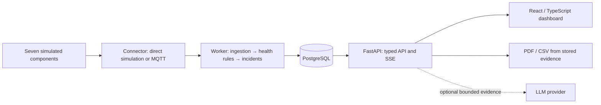

# IPHI — Industrial Platform Health Intelligence

IPHI helps an engineer answer: **which service in an industrial data platform is unhealthy, and what evidence explains it?** It monitors seven simulated components, stores metrics and logs, evaluates versioned rules, groups repeated alerts into incidents and makes the evidence available for investigation and export.

> **Simulated infrastructure.** No real plant, PLC or historian is connected. MQTT uses a real local broker carrying synthetic observations. IPHI is a personal demonstrator, with no commercial compatibility, certification or production-readiness claim. Monitoring and incident management work without an AI provider.

**Français :** IPHI supervise la santé d’une plateforme de données industrielles simulée. Pour installer et découvrir l’outil, suivez le [guide débutant en français](docs/debuter.md). L’interface et l’aide sont disponibles en français et en anglais ; choisissez **Français / English** dès la connexion. [English beginner guide](docs/getting-started.md).

## Try it locally

You need Git, Docker Engine with Compose v2, GNU Make, Python 3.10+ and curl. Docker must be running and your account must be able to use it. The first build needs internet access to download images and dependencies; no cloud account, model key or local Node/Python toolchain is needed for the container demo.

```sh
git clone https://github.com/bachiryaye/iphi.git
cd iphi
make demo IPHI_LLM_PROVIDER=none
```

Already have the repository? Run the last command from its root. It builds the application, applies migrations, seeds the platform and runs a checked walkthrough on the separate `iphi-demo` Compose project. It needs local ports **8081, 8001 and 5434**. The walkthrough takes about two minutes after the build on the reference setup; disk pressure can make it slower.

Expected result: `Demo passed in … s.` The script verifies collector failure, rising latency, stale process data, missing telemetry and repeated errors, including stable recovery. It then leaves a live collector incident for you to inspect.

1. Open **http://127.0.0.1:8081**. **Help** is available at [/help](http://127.0.0.1:8081/help), even before sign-in.
2. Open the local `.env` in an editor. The initializer generates missing passwords there and preserves existing configuration; the file is ignored by Git. For username `admin`, use `IPHI_DEMO_ADMIN_PASSWORD`; `engineer` and `viewer` have matching `IPHI_DEMO_*_PASSWORD` entries. Keep these values private.
3. Sign in, choose English or French, and open **Help for this page** for guidance. Language preference stays in this browser after reload; changing it preserves the current screen and filters.

| Account | What you can do |
|---|---|
| `viewer` | Inspect components, incidents, evidence and existing diagnoses; export PDF/CSV |
| `engineer` | Viewer actions, start/stop scenarios, change the clock, acknowledge/comment/diagnose/resolve incidents |
| `admin` | Engineer actions, reset the simulation and inspect Audit |

The server enforces roles. Acknowledging an incident does not fix the fault; resolution waits for its condition to clear. [Sessions and API access](docs/access.md).

## A short evaluator journey

After `make demo`, use the live incident left by the script:

1. **Overview**: find `collector-01` in `Critical`, the platform explanation and the active incident. Compare platform health with **Monitor status**, which describes IPHI itself.
2. **Incidents**: open the collector incident. Follow **Signal → Timeline → Evidence chain**; select a citation to locate its stored sample or evaluation.
3. Choose **Diagnose** as engineer/admin: facts, hypotheses, uncertainty and recommended checks reference evidence. No model is required. **AI diagnosis** is optional and separately labelled.
4. Choose **Export PDF** or **Export CSV**. Viewer can export too. Files identify the simulated environment and UTC.
5. **Scenarios → Active scenario runs → Stop** the `collector_down` run. Return to the incident and observe automatic resolution after stable recovery. The connectivity window is **300 s of platform time**, so allow about five minutes; engineer/admin can accelerate the clock. Avoid Reset when demonstrating normal recovery.

To provoke the fault yourself after recovery, open **Scenarios → Collector down**, keep `collector-01`, leave duration empty and choose **Start scenario** once. One active incident groups the repeated signals. See the [full checked walkthrough](docs/demo.md) or the in-app guide for every step and expected result.

**Understanding the labels:** `Unknown` means missing, stale or insufficient evidence, never Healthy. A failed active probe (`up = 0`) differs from missing telemetry. `data_age_s` tracks process-data freshness even when a service answers. Charts keep gaps visible and show units; UTC and browser-local time are identified. Switching language translates the interface, catalog and help, while technical keys, stored logs, explanations and diagnosis text keep their original language. **PDF/CSV reports remain English.**

## What it demonstrates

- Seven dependent components, reproducible seeded scenarios and a controllable platform clock.
- Validated, deduplicated PostgreSQL history and explainable rules with confirmation and recovery windows.
- Evidence-backed incident lifecycle, downstream impact, investigation comments and recorded state history.
- Live updates through SSE, accessible tables alongside graphs, light/dark themes, contextual help and EN/FR presentation.
- Deterministic diagnosis, optional guarded AI explanation with fallback, and PDF/CSV reporting.
- Local sessions, role checks, CSRF protection, audit and one optional MQTT transport.

US-01…US-12 are delivered; the [backlog](docs/03-backlog.md) and [decision records](docs/adr/README.md) describe the acceptance evidence and boundaries. For the portfolio narrative, read the [case study](docs/case-study.md) and [video script](docs/video-script.md).

## Architecture



A modular monolith: the API and worker share the same Python application/image. A single worker collects and evaluates every 5 s of platform time. React renders the server’s conclusions; it does not duplicate health rules. Docker Compose runs PostgreSQL, migrations/seed, API, worker and the Nginx frontend. [Detailed architecture](docs/02-architecture-technique.md).

## Daily use and stopping

Use the persistent development stack when you want to keep history:

```sh
make up IPHI_LLM_PROVIDER=none          # UI 8080, API 8000, PostgreSQL 5433
curl -i http://127.0.0.1:8000/health    # 200, {"status":"ok"}
curl -i http://127.0.0.1:8000/ready     # 200 after migrations and worker cycles; 503 if not ready
make logs                            # Ctrl+C stops following logs
make down                            # stops development stack, keeps its data
```

For the demo, health/readiness are on port 8001. API documentation is at `/docs` on the API port; operational reads require sign-in. All published service ports bind to loopback by default.

```sh
docker compose -p iphi-demo stop      # pause demo, keep its data
make demo-down                       # delete the demo stack AND its demo volume
```

**`make demo` also recreates the demo volume each time.** It leaves the development stack untouched. Use the correct project name when stopping services. Avoid sharing browser sessions between stacks on the same hostname; use separate profiles or sign in again.

## Tests and development

Outside containers, install uv ≥ 0.13, Node.js ≥ 24 and pnpm 12. PDF tests also require Pango/Harfbuzz libraries ([installation notes](docs/adr/0022-rapports-incidents-us09.md)).

```sh
make install                         # locked backend/frontend dependencies
make lint typecheck                  # Ruff, import contracts, ESLint, Prettier, mypy, TypeScript
make test-frontend                   # component, language and accessibility tests
make test-backend                    # real PostgreSQL integrations; default DB port 5433
make api-drift                       # generated OpenAPI/client contract matches the code
cd frontend && pnpm exec playwright install chromium && cd ..
make test-e2e                        # browser scenarios against the isolated demo
```

If port 5433 is occupied, run `make test-backend IPHI_DB_PORT=6433`; the test database URL follows that port. `make check` groups lint, types, backend/frontend tests and API drift. CI also checks image builds, migrations, secrets and dependency audits. `make screenshots` regenerates the current English dashboard captures from the running demo; it changes demo state. `make perf PERF_ARGS="--history-days 7"` is a separate local load test, not a fast smoke test.

## Common problems and known limits

| Symptom | Next action |
|---|---|
| Docker/Compose missing or daemon unavailable | Install/start Docker with Compose v2; verify `docker compose version` and `docker info` |
| A demo port is busy | `make demo IPHI_LLM_PROVIDER=none IPHI_DEMO_FRONTEND_PORT=9081 IPHI_DEMO_API_PORT=9001 IPHI_DEMO_DB_PORT=6434`, then open port 9081 |
| Unknown immediately after startup | Allow the worker to collect/evaluate; inspect `/ready` and **Monitor status** if it persists |
| Login refused / 401 / 403 | Check the local account and role; sign in again if expired. Admin is needed for reset/Audit |
| Login or diagnosis returns 429 | Wait for the rate-limit window before retrying |
| AI off or unavailable | Use deterministic **Diagnose**; monitoring remains independent |
| Report busy or too large | Retry a busy export; oversized incidents remain accessible in evidence/event lists |
| Slow startup, detection or tests | Inspect `docker compose -p iphi-demo logs --tail 50 worker` and host disk load; measured limits are documented below |

Seven-day aggregated metrics missed the **300 ms p95 target** on the reference spinning-disk host (337–613 ms measured). Local I/O stalls also affected commits and browser startup. These are disclosed in [performance results](docs/performance.md); they are not production benchmarks. Pattern-based redaction and citation checks do not establish factual truth. No automatic remediation, real OT writes, OPC UA, AVEVA PI compatibility or real-plant validation is provided.

## Further reading

[Beginner guide](docs/getting-started.md) · [Guide français](docs/debuter.md) · [Demo and expected output](docs/demo.md) · [Access and roles](docs/access.md) · [Optional diagnosis](docs/diagnosis.md) · [MQTT setup](docs/mqtt.md) · [Case study](docs/case-study.md) · [Language/help decision](docs/adr/0027-bilingual-help.md)
