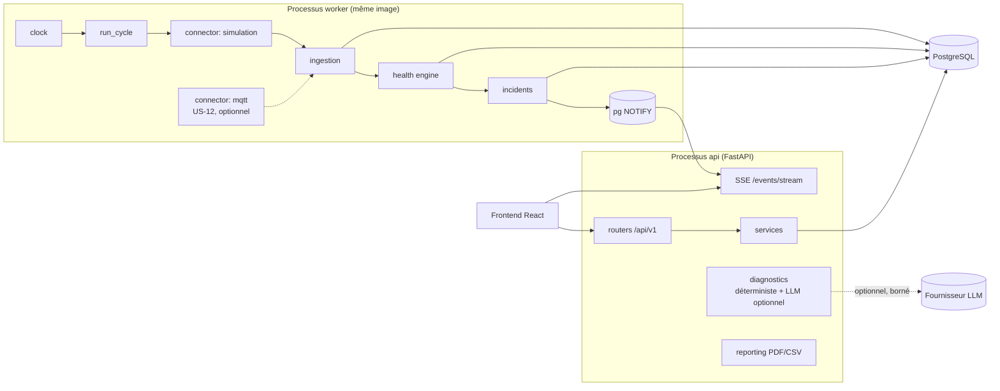
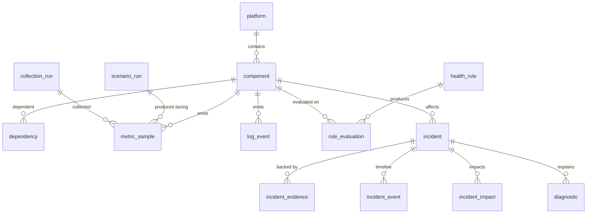
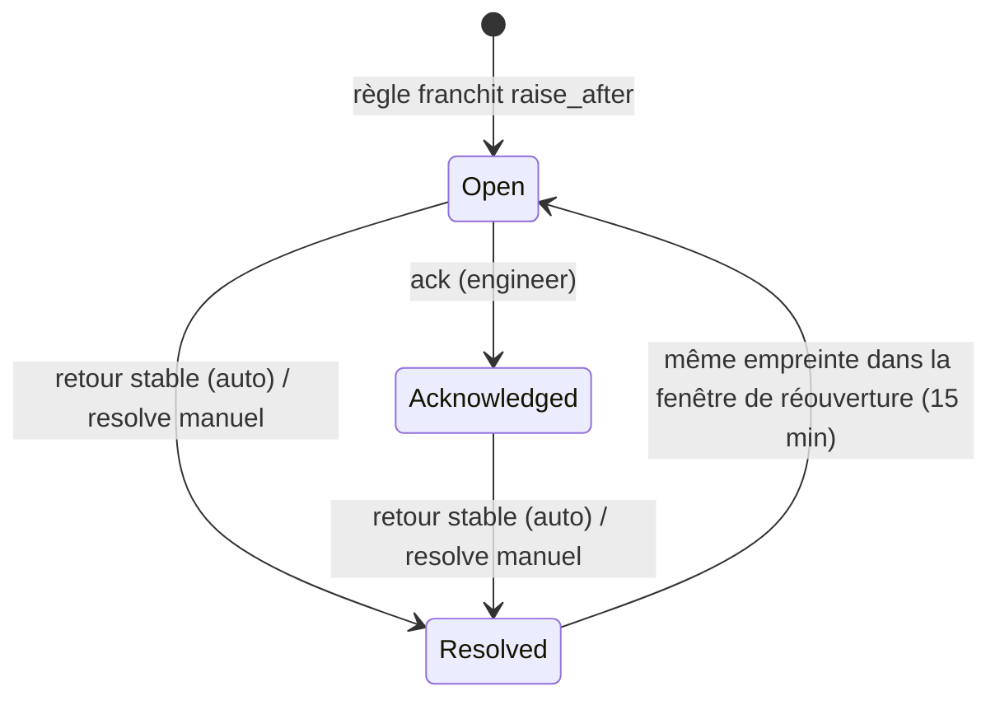

# Architecture technique détaillée

**Industrial Platform Health Intelligence — décisions, composants, données, API, sécurité et jalons**

*IPHI  |  Dossier de conception  |  Version 1.1  |  12 novembre 2026*

> **Statut :** référence approuvée pour l'implémentation. La v1.0 d'origine est conservée dans
> `docs/archive/v1.0/02-architecture-technique.md` (et en DOCX/PDF à la racine).
> Les décisions structurantes sont détaillées dans `docs/adr/`. Le design de l'interface est
> spécifié dans `docs/04-design-system.md`.

## Historique des versions

| Version | Date | Changements |
|---|---|---|
| 1.0 | 2026-11-12 | Version initiale. |
| 1.1 | 2026-11-12 | Revue de cohérence : topologie d'exécution api/worker, horloge simulée, sondes actives, deux notions de fraîcheur, propagation d'impact, politique d'agrégation, cycle de vie complet des incidents, modèle de données complété, catalogue d'API complet, schéma de diagnostic unifié (§06.1), rapports PDF **et** CSV, objectifs de performance chiffrés, catalogue de scénarios, choix frontend et design system. |

## 01 — Décisions structurantes

Architecture retenue : monolithe modulaire FastAPI, frontend React/TypeScript séparé, PostgreSQL, simulateur et connecteurs interchangeables. Un seul dépôt Git et un environnement Docker Compose reproductible.

Pourquoi : simplifier le développement, les tests et la démonstration tout en préservant des frontières explicites. Pas de microservices distribués pour la V1.

| Décision | Choix | Justification | ADR |
|---|---|---|---|
| Backend | Python 3.12+ / FastAPI / Pydantic v2 / SQLAlchemy 2 | API typée, validation Pydantic | 0001 |
| Frontend | React / TypeScript / Vite | Interface moderne, composants testables | 0009 |
| Données | PostgreSQL 16 / Alembic | Historique relationnel et migrations | 0008 |
| Jobs | Scheduler interne dans un processus `worker` dédié (même image que l'API) | Suffisant en prototype; évite l'exécution multiple des jobs | 0001 |
| Horloge | Horloge de plateforme simulée (`realtime`, `accelerated`, `manual`) | Reproductibilité et tests déterministes | 0002 |
| Temps réel | SSE alimenté par PostgreSQL `LISTEN/NOTIFY` (WebSocket non retenu en V1) | Flux serveur vers dashboard, sans broker supplémentaire | 0001 |
| IA | Adaptateur LLM + schéma JSON validé; diagnostic déterministe toujours disponible | Fournisseur interchangeable et garde-fous | 0006 |
| Packaging | Docker Compose / GitHub Actions | Reproductibilité et CI | 0010 |
| Outillage | `uv` (Python), `pnpm` (frontend), Ruff, mypy strict, pytest, Vitest, Playwright | Rapide, reproductible, lockfiles | 0010 |
| Langue | Interface et API en anglais ; documentation de conception en français ; README en anglais avec résumé français | Vocabulaire standard de l'industrie, audience internationale | 0010 |

## 02 — Vue des composants

Flux principal : simulateur / adaptateurs → ingestion → stockage des observations → évaluation des règles → incidents → diagnostic contextualisé → API → interface. Les métriques et événements sont horodatés en UTC.

- simulation : génère métriques, logs, états et scénarios de défaillance reproductibles avec graine configurable.
- ingestion : reçoit, normalise, valide, déduplique et stocke les observations.
- health : calcule les états Healthy, Warning, Critical, Unknown, avec règles versionnées et hystérésis.
- incidents : regroupe les alertes, maintient un cycle de vie, conserve les preuves.
- diagnostics : corrèle les événements et interroge facultativement le LLM.
- reporting : produit synthèses CSV/PDF et exports des preuves.
- identity : authentification, rôles et audit des actions sensibles.
- connectors : contrats de collecte pour simulation, REST, puis MQTT/OPC UA.

*Précisions v1.1 :*

- **clock** (`core/clock.py`) : horloge de plateforme unique, injectée partout ; aucun module n'appelle `datetime.now()` directement pour un horodatage métier.
- **connectors** : en V1, seuls le connecteur `simulation` (P0) et un connecteur `mqtt` (US-12, P2) sont implémentés. REST, OPC UA et Prometheus restent des extensions documentées, non implémentées.
- **monitor** (observabilité d'IPHI lui-même) : battement du worker, durée et retard des cycles, résultats de collecte, disponibilité du fournisseur IA.



### 02.1 — Topologie d'exécution (Compose)

| Service | Rôle | Exposition |
|---|---|---|
| `db` | PostgreSQL 16 | Réseau Compose uniquement (port local `127.0.0.1:5432` en dev) |
| `migrate` | `alembic upgrade head`, puis chargement idempotent du seed (plateforme, composants, règles) | Job one-shot |
| `api` | FastAPI (uvicorn), routes HTTP + SSE | `127.0.0.1:8000` |
| `worker` | Scheduler : boucle `run_cycle` unique, protégée par un *advisory lock* PostgreSQL (une seule instance active) | Aucune |
| `frontend` | Vite (dev) ou Nginx statique (build) | `127.0.0.1:5173` / `127.0.0.1:8080` |
| `mosquitto` | Broker MQTT, profil Compose `mqtt` uniquement (US-12) | Réseau Compose |

L'`api` et le `worker` partagent le même code et la même image ; ce sont deux points d'entrée d'un même monolithe modulaire, pas deux microservices.

### 02.2 — Cycle de traitement (`run_cycle`)

Chaque cycle (par défaut toutes les 5 s d'horloge de plateforme) exécute **séquentiellement et de manière transactionnelle** :

1. lire l'horloge et les `scenario_run` actifs ;
2. collecter via chaque connecteur actif (isolé : l'échec d'un connecteur est enregistré dans `collection_run` et n'interrompt pas les autres) ;
3. valider, dédupliquer et persister les observations ;
4. évaluer les règles applicables (avec état d'hystérésis persistant) ;
5. recalculer l'état des composants, l'impact et l'état agrégé de la plateforme ;
6. ouvrir / mettre à jour / résoudre les incidents ;
7. publier les changements via `NOTIFY iphi_events` ;
8. écrire le battement du worker (`monitor_heartbeat`).

`run_cycle(now)` est une fonction pure côté orchestration, appelable directement depuis les tests sans scheduler : c'est la base des tests d'intégration déterministes.

### 02.3 — Horloge de plateforme (ADR 0002)

- Modes : `realtime` (1 s simulée = 1 s réelle, ancrée à l'heure UTC de démarrage), `accelerated` (facteur configurable, ex. ×10), `manual` (avance uniquement sur commande — tests et démonstration pas à pas).
- Tous les horodatages métier (`observed_at`, `evaluated_at`, `opened_at`…) utilisent l'horloge de plateforme. Les actions humaines (`audit_event.occurred_at`) utilisent l'heure murale UTC et enregistrent aussi l'heure de plateforme.
- Le générateur du simulateur est une **fonction pure** `f(seed, composant, métrique, tick, scénarios actifs)` basée sur un générateur pseudo-aléatoire à compteur (hachage du quadruplet) : mêmes seed, scénarios et ticks ⇒ mêmes valeurs, indépendamment de l'ordre d'exécution ou d'un redémarrage.

## 03 — Modèle de données logique

| Entité | Champs essentiels / relations |
|---|---|
| platform | id, name, environment, created_at |
| component | id, platform_id, type, criticality, status, config |
| dependency | source_component_id, target_component_id, kind |
| metric_sample | id, component_id, metric_name, value, unit, observed_at, source |
| log_event | id, component_id, severity, message, observed_at, fingerprint |
| health_rule | id, metric_name, operator, threshold, severity, window, enabled, version |
| rule_evaluation | id, rule_id, component_id, status, evidence, evaluated_at |
| incident | id, component_id, status, severity, opened_at, resolved_at, fingerprint |
| incident_evidence | incident_id, observation_type, observation_id |
| diagnostic | id, incident_id, model, facts, hypotheses, recommendations, confidence_label |
| audit_event | id, actor_id, action, target, occurred_at |

Toutes les entités doivent avoir des migrations et contraintes d'intégrité. Ne pas mettre les données simulées et réelles dans un même environnement sans étiquetage explicite.

### 03.1 — Modèle détaillé v1.1 (référence pour les migrations)

Le tableau ci-dessus (v1.0) reste le socle logique ; le modèle ci-dessous le précise et le complète. Identifiants : UUID (v7, triables) pour les entités métier, `BIGINT IDENTITY` pour les tables volumineuses d'observations. Tous les horodatages sont `timestamptz` UTC.

**Topologie**

| Table | Champs | Contraintes / index |
|---|---|---|
| `platform` | id, key, name, environment (`simulation` \| `lab` \| `production`), created_at | `key` unique. En V1, seul `simulation` est autorisé (contrainte CHECK levée par ADR futur). |
| `component` | id, platform_id, key, name, type (`source` \| `gateway` \| `collector` \| `historian` \| `database` \| `api` \| `analytics`), criticality (`high` \| `medium` \| `low`), config (jsonb), created_at | unique (platform_id, key). **Pas de colonne `status`** : l'état simulé vit dans le simulateur, l'état de santé calculé dans `component_health`. |
| `dependency` | id, platform_id, dependent_component_id, dependency_component_id, kind (`data_flow` \| `runtime`) | Sens : **`dependent` dépend de `dependency`** (les données circulent de `dependency` vers `dependent`). unique (dependent, dependency) ; CHECK dependent ≠ dependency ; graphe acyclique vérifié au seed. Remplace `source/target` (v1.0), jugés ambigus. |
| `component_health` | component_id (PK), state, since, last_evaluated_at, reason_evaluation_id, impacted_by (uuid[]) | Instantané dérivé de l'état courant, recalculé à chaque cycle ; `reason_evaluation_id` = évaluation de la règle décisive (aucune si Healthy, ADR 0016). |
| `platform_health` | platform_id (PK), state, since, last_evaluated_at, counts (jsonb), priority, rationale, decided_by (uuid[]) | Instantané dérivé ; `priority` et `rationale` = ligne de la table d'agrégation appliquée, `decided_by` = composants décisifs. |

**Simulation et collecte**

| Table | Champs | Contraintes / index |
|---|---|---|
| `sim_clock` | id (=1), mode, speed, anchor_platform_time, anchor_wall_time, seed, updated_at | Ligne unique. `current_time` renommé `anchor_platform_time` (ADR 0014). |
| `scenario_run` | id, number (identité, `#N`), platform_id, scenario_key, target_component_id, seed, parameters (jsonb), started_at, ends_at (fin planifiée), stopped_at, status (`active` \| `stopped` \| `completed`), started_by, created_at | index (status) ; index uniques partiels : une panne active par composant, un `baseline` actif par plateforme (ADR 0014). Chaque observation produite pendant un scénario y est rattachée. |
| `collection_run` | id, connector_key, source, started_at, finished_at, status (`ok` \| `partial` \| `failed`), sample_count, log_count, rejected_count, duplicate_count, rejections (jsonb, par code), watermark, error_code, error_message | index (connector_key, started_at), (started_at). Alimente l'observabilité du moniteur ; horodatages en heure murale (ADR 0015). |
| `collection_cursor` | connector_key (PK), source, watermark, updated_at | Point de reprise de chaque connecteur (temps d'événement) ; vidé par le reset avec les observations (ADR 0015). |
| `metric_definition` | metric_name (PK), unit, description, min_value, max_value, kind (`gauge` \| `counter` \| `ratio`) | Catalogue chargé depuis la configuration ; toute métrique inconnue ou unité incohérente est rejetée. |

**Observations**

| Table | Champs | Contraintes / index |
|---|---|---|
| `metric_sample` | id, component_id, metric_name, value, unit, quality (`good` \| `uncertain` \| `bad`), observed_at, received_at, source (`simulation` \| `mqtt`), scenario_run_id, collection_run_id | unique (component_id, metric_name, observed_at, source) ⇒ doublons ignorés (`ON CONFLICT DO NOTHING`, compté) ; cette contrainte sert aussi les lectures de séries (pas d'index composite séparé, ADR 0015). BRIN (observed_at). |
| `log_event` | id, component_id, severity (`debug` \| `info` \| `warning` \| `error` \| `critical`), message (≤ 2 000 car.), fingerprint, dedup_key, attributes (jsonb, ≤ 8 Ko), observed_at, received_at, source, scenario_run_id, collection_run_id | unique (component_id, observed_at, source, dedup_key) ⇒ re-livraisons ignorées, et lectures par composant ; index (fingerprint, observed_at) ; BRIN (observed_at). |

Observations tardives : acceptées si `observed_at` ≥ `now − late_tolerance` (défaut 10 min), sinon rejetées et comptées. Observations dans le futur au-delà de 30 s : rejetées. Valeurs hors plage `metric_definition` : rejetées avec code `METRIC_OUT_OF_RANGE`. Tout rejet est compté dans `collection_run.rejected_count` et journalisé.

**Santé**

| Table | Champs | Contraintes / index |
|---|---|---|
| `health_rule` | id, key (ex. `R-LAT-001`), version, rule_type (`threshold` \| `freshness` \| `absence` \| `availability_ratio`), failure_class, target_selector (jsonb : types et clés de composant, union ; vide = tous), metric_name, aggregation (`last` \| `avg` \| `max` \| `p95` \| `sum` \| `ratio`), window_seconds, operator (`gt` \| `ge` \| `lt`), warning_threshold, critical_threshold, warning_clear, critical_clear, raise_after, clear_after, min_samples, rationale, recommendation, enabled, created_at | unique (key, version). **Versions immuables** (trigger : ni `UPDATE` ni `DELETE`) : toute modification crée une nouvelle version, une règle retirée du fichier une version désactivée. Source : fichier `config/health_rules.yaml` versionné, chargé au bootstrap (ADR 0016). |
| `rule_state` | component_id, rule_key, rule_id, state, since, pending_state, raw_streak, raw_state, observed_value, sample_count, explanation, evidence, last_evaluated_at, last_evaluation_id, state_evaluation_id | PK (component_id, rule_key). Persiste l'hystérésis entre redémarrages (`pending_state` + `raw_streak` = transition en cours) et la mesure du dernier créneau ; `state_evaluation_id` = évaluation qui a fixé l'état. |
| `rule_evaluation` | id (`BIGINT`), rule_id, component_id, evaluated_at, window_start (exclusif ; la fenêtre finit à evaluated_at), observed_value, sample_count, raw_state, state, explanation, evidence (jsonb : ids de samples/logs, ≤ 50) | unique (component_id, rule_id, evaluated_at) ; index (component_id, evaluated_at), (rule_id, evaluated_at), (evaluated_at, id). Une évaluation par créneau de 5 s (ADR 0016) ; persistée à la première évaluation, à chaque **changement d'état**, toutes les 60 s de plateforme (battement) et chaque fois qu'elle sert de preuve à un incident. |

`failure_class` ∈ `availability`, `latency`, `freshness`, `errors`, `resources`, `backlog`, `connectivity`, `telemetry_loss`.

**Incidents**

| Table | Champs | Contraintes / index |
|---|---|---|
| `incident` | id, platform_id, component_id, failure_class, fingerprint, title, status (`open` \| `acknowledged` \| `resolved`), severity (`warning` \| `critical`), peak_severity, opened_at, last_seen_at, acknowledged_at, acknowledged_by, resolved_at, resolved_by, resolution (`auto_recovered` \| `manual`), occurrence_count, reopen_count, scenario_run_id, source | **index unique partiel** (fingerprint) WHERE status ≠ `resolved` ⇒ au plus un incident actif par empreinte, garanti par la base. index (status, opened_at desc), (component_id, opened_at desc). |
| `incident_evidence` | id, incident_id, metric_sample_id, log_event_id, rule_evaluation_id, role (`trigger` \| `supporting` \| `impact` \| `recovery`), added_at | CHECK : exactement une des trois FK non nulle (intégrité référentielle réelle, pas de lien polymorphe). unique (incident_id, metric_sample_id, log_event_id, rule_evaluation_id). |
| `incident_impact` | incident_id, component_id, since | PK (incident_id, component_id). Composants en aval impactés. |
| `incident_event` | id, incident_id, event_type (`opened` \| `occurrence` \| `severity_changed` \| `acknowledged` \| `commented` \| `resolved` \| `reopened` \| `downstream_suppressed` \| `diagnostic_added`), actor_type (`system` \| `user`), actor_id, occurred_at, payload (jsonb) | index (incident_id, occurred_at). Chronologie complète, append-only ; les **commentaires** sont des événements `commented` (corps ≤ 4 000 car.). |

**Diagnostic, identité, audit**

| Table | Champs | Contraintes / index |
|---|---|---|
| `diagnostic` | id, incident_id, kind (`deterministic` \| `llm`), provider, model, status (`succeeded` \| `failed` \| `rejected`), observed_facts, hypotheses, recommended_checks, limitations (jsonb, schéma §06), evidence_set_hash, validation_report (jsonb), prompt_redacted (llm, ≤ 32 Ko), input_tokens, output_tokens, latency_ms, error_code, created_by, created_at | index (incident_id, created_at desc). Remplace `facts/recommendations/confidence_label` (v1.0) par le schéma de §06.1. |
| `app_user` (US-11) | id, username, display_name, role (`viewer` \| `engineer` \| `admin`), password_hash (Argon2id), is_active, created_at | unique (username). |
| `user_session` (US-11) | id, token_hash, user_id, created_at, expires_at, revoked_at | index (token_hash). |
| `audit_event` | id, occurred_at, platform_time, actor_id, actor_label, action, target_type, target_id, outcome (`allowed` \| `denied` \| `failed`), correlation_id, details (jsonb) | index (occurred_at desc), (action). Append-only ; les tentatives **refusées** sont enregistrées. |
| `monitor_heartbeat` | process (PK), last_cycle_at, last_cycle_duration_ms, cycle_lag_ms, status | Observabilité du moniteur. |

**Rétention.** Observations (`metric_sample`, `log_event`) et évaluations non référencées : 7 jours d'horloge de plateforme (configurable), purgées par un job du worker. Toute observation **référencée comme preuve** d'un incident est conservée tant que l'incident existe. Les incidents, événements, diagnostics et audits ne sont jamais purgés automatiquement.



## 04 — Contrats API et événements

| Route indicative | Comportement |
|---|---|
| GET /api/v1/platforms | Liste des plateformes et états agrégés |
| GET /api/v1/components/{id} | Détails, dépendances et métriques |
| GET /api/v1/metrics | Séries filtrées par composant/période |
| GET /api/v1/incidents | Recherche, filtre et pagination |
| POST /api/v1/incidents/{id}/ack | Accusé de réception audité |
| POST /api/v1/incidents/{id}/diagnose | Diagnostic IA sur preuves persistées |
| POST /api/v1/simulations/scenarios | Déclenchement d'un scénario autorisé |
| GET /api/v1/events/stream | SSE des changements d'état |
| GET /api/v1/reports/incidents/{id} | Export PDF |

Conventions : OpenAPI auto-générée, modèles Pydantic, pagination, erreurs structurées, idempotence des opérations sensibles, dates ISO-8601 UTC, correlation_id dans les logs.

### 04.1 — Catalogue complet v1.1

Le tableau v1.0 ci-dessus est conservé et étendu. Colonne *Story* = story qui livre la route ; *Rôle* = rôle minimal à partir de US-11 (avant US-11, voir §07.1).

| Méthode / route | Comportement | Story | Rôle |
|---|---|---|---|
| GET /health | Liveness (processus vivant) | US-01 | public |
| GET /ready | Readiness : DB joignable, migrations à jour, battement worker récent, statut fournisseur IA | US-01 | public |
| GET /api/v1/system/status | Observabilité du moniteur : horloge, dernier cycle, retard, derniers `collection_run`, fournisseur IA | US-03 | viewer |
| GET /api/v1/platforms | Plateformes, état agrégé, compteurs par état, justification de l'agrégation | US-04 | viewer |
| GET /api/v1/platforms/{id}/topology | Nœuds (composants + état + impact) et arêtes (dépendances, sens explicite) | US-04 | viewer |
| GET /api/v1/components | Liste filtrable avec état courant ; à partir de US-06, `key_metric` par composant (métrique choisie côté serveur, valeur, unité, bornes d'affichage, seuils, règle, état) pour le `RangeMeter` (design system §6.1) | US-04 / US-06 | viewer |
| GET /api/v1/components/{id} | Détails, dépendances amont/aval, état courant, `impacted_by` | US-04 | viewer |
| GET /api/v1/components/{id}/health | Dernières évaluations par règle avec justification (règle/version, fenêtre, seuil, valeur, preuves) | US-04 | viewer |
| GET /api/v1/components/{id}/state-history | Segments d'état (`state`, `from`, `to`, `evaluation_ids`) du composant et de chaque règle sur une fenêtre ; pire état par intervalle en sous-échantillonnage (`max_segments`) — `StateBand` (design system §6.3) | US-07 | viewer |
| GET /api/v1/metrics/catalog | Métriques disponibles, unités, plages | US-03 | viewer |
| GET /api/v1/metrics | Série `component_id` + `metric_name` + `from`/`to` (fenêtre ≤ 7 j) ; sous-échantillonnage serveur (`max_points` ≤ 2 000, agrégation `date_bin` min/avg/max) ; les **trous restent des trous** | US-03 | viewer |
| GET /api/v1/logs | Logs filtrés (composant, sévérité, période), pagination par curseur | US-03 | viewer |
| GET /api/v1/health-rules | Règles actives et versions (lecture seule) | US-04 | viewer |
| GET /api/v1/rule-evaluations | Historique d'évaluations filtré | US-04 | viewer |
| GET /api/v1/incidents | Recherche (statut, sévérité, composant, classe, période), pagination par curseur | US-05 | viewer |
| GET /api/v1/incidents/{id} | Détail : preuves, chronologie, composants impactés, diagnostics | US-05 | viewer |
| POST /api/v1/incidents/{id}/ack | Accusé de réception (idempotent : un second appel renvoie l'état courant) | US-05 | engineer |
| POST /api/v1/incidents/{id}/resolve | Résolution manuelle avec commentaire obligatoire ; `409 INCIDENT_CONDITION_ACTIVE` si la condition persiste | US-05 | engineer |
| POST /api/v1/incidents/{id}/comments | Ajout de commentaire (événement `commented`) | US-07 | engineer |
| POST /api/v1/incidents/{id}/diagnose | `mode=deterministic` (US-05) \| `llm` (US-08) ; en-tête `Idempotency-Key` accepté | US-05 / US-08 | engineer |
| GET /api/v1/incidents/{id}/diagnostics | Diagnostics persistés | US-05 | viewer |
| GET /api/v1/simulations/scenarios | Catalogue : clé, description, composant cible par défaut, paramètres, **résultat attendu** | US-02 | viewer |
| POST /api/v1/simulations/scenarios | Démarre un `scenario_run` (clé, cible, durée, paramètres bornés) | US-02 | engineer |
| GET /api/v1/simulations/runs | Scénarios actifs et historiques | US-02 | viewer |
| POST /api/v1/simulations/runs/{id}/stop | Arrêt d'un scénario | US-02 | engineer |
| POST /api/v1/simulations/reset | Arrête les scénarios, réinitialise horloge et seed, purge les observations simulées et l'état de santé qui en dérive (pas l'audit) | US-02 | admin |
| GET /api/v1/simulations/clock | État de l'horloge | US-02 | viewer |
| POST /api/v1/simulations/clock | Changer de mode / avancer de N secondes (mode `manual`) | US-02 | engineer |
| GET /api/v1/events/stream | SSE (voir §04.3) | US-07 | viewer |
| GET /api/v1/reports/incidents/{id}?format=pdf\|csv | Export PDF **ou** CSV | US-09 | viewer |
| POST /api/v1/auth/login · POST /api/v1/auth/logout · GET /api/v1/auth/me | Session | US-11 | public / authentifié |
| GET /api/v1/audit-events | Journal d'audit filtré | US-11 | admin |

**Ingestion :** pas de route HTTP d'ingestion publique en V1. Les connecteurs s'exécutent dans le worker et appellent directement le service d'ingestion via l'interface `Connector` (voir §04.4). Cela réduit la surface d'attaque ; une route d'ingestion authentifiée pourra être ajoutée par ADR.

### 04.2 — Conventions

- Erreurs au format **RFC 9457** (`application/problem+json`) étendu : `type`, `title`, `status`, `detail`, `code` (machine-readable, ex. `INCIDENT_NOT_FOUND`), `correlation_id`, `errors[]` (validation).
- En-tête `X-Correlation-ID` accepté et renvoyé ; propagé dans les logs structurés (JSON) et dans `audit_event`.
- Pagination par curseur opaque (keyset sur `(horodatage, id)`), `limit` défaut 50, max 200, ordre stable.
- Dates ISO-8601 UTC avec suffixe `Z`. Durées en secondes.
- Toute réponse de données simulées porte `source` et, au niveau plateforme, `environment: "simulation"`.
- Corps de requête limité à 64 Ko ; chaînes utilisateur bornées et validées.
- Client TypeScript **généré** depuis l'OpenAPI (`openapi-typescript`), vérifié en CI (pas de dérive).

### 04.3 — Événements SSE

Le worker publie `NOTIFY iphi_events` (payload JSON minimal : `type`, `id`, `platform_time`) ; l'API relaie vers les clients SSE.

| Type | Déclencheur |
|---|---|
| `platform.health_changed` | Changement d'état agrégé |
| `component.health_changed` | Changement d'état d'un composant |
| `incident.opened` / `incident.updated` / `incident.resolved` | Cycle de vie |
| `scenario.changed` | Démarrage / arrêt / reset |
| `monitor.status` | Changement d'état du moniteur (worker en retard, fournisseur IA indisponible) |
| `heartbeat` | Toutes les 15 s |

Le client invalide ses caches à la réception (les événements ne transportent pas l'état complet) ; à la reconnexion, il revalide tout. Si le flux est indisponible, l'interface bascule en rafraîchissement périodique (30 s) et l'indique clairement.

### 04.4 — Contrat connecteur

```python
class Connector(Protocol):
    key: str                       # "simulation", "mqtt"
    source: ObservationSource      # valeur stockée dans metric_sample.source
    def collect(self, request: CollectionRequest) -> CollectionResult: ...
# CollectionRequest = now (heure de plateforme), resume_after (watermark persisté ou None),
#                     not_before (plus ancienne observation acceptée)
# CollectionResult = samples[], logs[], issues[], watermark
# Une exception du connecteur est enregistrée en collection_run « failed » (ADR 0015).
```

Le moteur métier (health, incidents) ne connaît que les observations normalisées : brancher un nouveau connecteur ne modifie ni les règles ni le dashboard (critère US-12).

## 05 — Moteur de santé et incidents

Une règle évalue une métrique sur une fenêtre et produit une observation explicable. Unknown signifie absence de preuve récente; ne doit pas être interprété comme Healthy. Les alertes utilisent une fenêtre ou hystérésis pour éviter les oscillations.

Agrégation : un composant critique en état Critical rend l'état global Critical selon une politique explicite. Les incidents sont regroupés par fingerprint et composant pour éviter les doublons. Cycle : Open → Acknowledged → Resolved (avec réouverture documentée).

Cas de test obligatoires : service down, latence croissante, stale data malgré service up, surcharge simulée, incident répété, retour à la normale, absence de métriques.

### 05.1 — Sondes actives : distinguer Critical et Unknown (ADR 0003)

Un service arrêté ne produit plus de métriques : sans précaution, « service down » et « plus de données » seraient indiscernables. Chaque connecteur **sonde activement** chaque composant à chaque cycle et produit toujours une observation `up` (1 = répond, 0 = ne répond pas) accompagnée de `probe_latency_ms`.

| Situation | Observation | État |
|---|---|---|
| Le composant ne répond pas à la sonde | `up = 0` (observation explicite) | `Critical` (règle `R-AVAIL-001`) |
| La sonde elle-même n'a rien produit (connecteur en échec, worker arrêté) | absence d'observation | `Unknown` (règle `R-TEL-001`) |
| Données insuffisantes dans la fenêtre d'une règle | moins de `min_samples` | `Unknown` pour cette règle |

### 05.2 — Deux notions de fraîcheur (ADR 0003)

| Notion | Question | Métrique | Effet |
|---|---|---|---|
| **Fraîcheur de télémétrie** | IPHI reçoit-il encore des observations sur ce composant ? | âge de la dernière observation reçue | Absence ⇒ `Unknown` + incident `telemetry_loss` (le moniteur ne doit jamais rester « vert » en aveugle) |
| **Fraîcheur des données métier** | Les données procédé transportées par le composant sont-elles à jour ? | `data_age_s` (âge de la dernière valeur procédé traitée) | Service `up = 1` mais `data_age_s` élevé ⇒ `Warning`/`Critical`, incident `freshness` **distinct** d'une panne de service |

### 05.3 — Règles par défaut (`config/health_rules.yaml`)

| Clé | Type | Métrique / agrégation | Warning (clear) | Critical (clear) | Fenêtre | raise / clear | Classe |
|---|---|---|---|---|---|---|---|
| R-AVAIL-001 | threshold | `up` / last | — | `lt 1` (`≥ 1`) | 10 s | 2 / 3 | availability |
| R-CONN-001 | availability_ratio | `up` / ratio | `< 0.95` (`≥ 0.98`) | `< 0.80` (`≥ 0.90`) | 300 s | 1 / 3 | connectivity |
| R-LAT-001 | threshold | `probe_latency_ms` / p95 | `> 250` (`≤ 200`) | `> 1000` (`≤ 800`) | 60 s | 3 / 3 | latency |
| R-FRESH-001 | freshness | `data_age_s` / last — historian, analytics | `> 60` (`≤ 30`) | `> 300` (`≤ 120`) | 10 s | 2 / 3 | freshness |
| R-ERR-001 | threshold | `error_count` / sum | `≥ 5` (`< 2`) | `≥ 20` (`< 5`) | 60 s | 1 / 3 | errors |
| R-RES-001 | threshold | `cpu_pct` / avg | `> 85` (`≤ 75`) | `> 95` (`≤ 90`) | 120 s | 2 / 3 | resources |
| R-RES-002 | threshold | `mem_pct` / avg | `> 85` (`≤ 75`) | `> 95` (`≤ 90`) | 120 s | 2 / 3 | resources |
| R-QUEUE-001 | threshold | `queue_depth` / last — gateway, collector | `> 1 000` (`≤ 500`) | `> 5 000` (`≤ 2 000`) | 30 s | 2 / 3 | backlog |
| R-TEL-001 | absence | toute observation | — | aucune depuis 3 × intervalle ⇒ `Unknown` | 15 s | 1 / 2 | telemetry_loss |

*Précision US-04 (ADR 0016) :* une règle porte une seule métrique (R-RES-001 scindée en `cpu_pct` / `mem_pct`) ; un niveau retombe quand sa comparaison n'est plus vraie au seuil de retour ; une règle s'évalue à chaque créneau de 5 s, fenêtre `(t − fenêtre, t]`, échantillons `bad` exclus, Unknown sous `min_samples` (1 par défaut).

Hystérésis : passer à un état plus grave exige `raise_after` évaluations consécutives au-delà du seuil ; revenir exige `clear_after` évaluations consécutives en deçà du seuil de retour (`clear`). L'ordre de sévérité `Critical > Unknown > Warning > Healthy` vaut aussi ici : la perte de preuve se débruite comme une dégradation depuis Healthy ou Warning, et une panne confirmée est maintenue `clear_after` évaluations avant de passer Unknown (ADR 0016). Les seuils sont des valeurs de démonstration documentées, pas des recommandations industrielles.

### 05.4 — État d'un composant et agrégation (ADR 0004)

- **État d'un composant** = pire état de ses règles, avec l'ordre `Critical > Unknown > Warning > Healthy`. Un composant sans aucune évaluation récente est `Unknown`, jamais `Healthy`.
- **Impact** : un composant dont une dépendance amont (transitive) est `Critical` ou `Unknown` est marqué **impacté** (`impacted_by`). L'impact est une annotation, **pas un état** : il n'aggrave pas l'état propre du composant.
- **État de la plateforme** (pas de moyenne) :

| Priorité | Condition | État plateforme |
|---|---|---|
| 1 | au moins un composant de criticité `high` ou `medium` en `Critical` | `Critical` |
| 2 | au moins un composant `high` en `Unknown` | `Unknown` |
| 3 | au moins un composant en `Warning`, ou `Critical` de criticité `low`, ou `Unknown` de criticité `medium`/`low` | `Warning` |
| 4 | tous `Healthy` | `Healthy` |

La réponse API inclut toujours les compteurs par état et la ligne de priorité appliquée (`rationale`).

### 05.5 — Cycle de vie et déduplication des incidents (ADR 0005)



- **Empreinte** = `sha256(platform_id | component_id | failure_class)`. Unicité des incidents actifs garantie par index partiel ; une nouvelle occurrence met à jour `last_seen_at`, `occurrence_count` et ajoute des preuves au **même** incident.
- **Sévérité** : peut s'aggraver (`warning → critical`, événement `severity_changed`) ; `peak_severity` conserve le maximum.
- **Résolution automatique** : quand toutes les règles de la classe sont revenues `Healthy` (après `clear_after`), acteur `system`, `resolution = auto_recovered`, preuve `recovery` ajoutée.
- **Résolution manuelle** : commentaire obligatoire ; refusée (`409`) si la condition est encore active.
- **Réouverture** : même empreinte dans les 15 min (horloge de plateforme) après résolution ⇒ réouverture (`reopen_count + 1`) ; au-delà ⇒ nouvel incident.
- **Suppression en aval (anti-tempête)** : si une règle se déclenche sur un composant dont une dépendance amont a un incident actif `availability`/`connectivity`/`telemetry_loss` ouvert avant lui, aucun nouvel incident n'est ouvert ; le composant est ajouté à `incident_impact` de l'incident amont avec une preuve `impact` et un événement `downstream_suppressed`. Exception : la classe `freshness` sur un composant dont l'amont est sain reste un incident distinct.
- Aucune suppression de preuve ; transitions dans une transaction ; chaque transition produit un `incident_event` et (pour les actions humaines) un `audit_event`.

### 05.6 — Catalogue des scénarios et topologie simulée

Topologie simulée (fictive, sans lien avec un produit réel) :

| Clé | Type | Criticité | Dépend de |
|---|---|---|---|
| `plc-sim-01` | source (PLC / capteurs simulés) | high | — |
| `edge-gateway-01` | gateway | high | plc-sim-01 |
| `collector-01` | collector | high | edge-gateway-01 |
| `historian-01` | historian | high | collector-01, timeseries-db-01 |
| `timeseries-db-01` | database | high | — |
| `data-api-01` | api | medium | historian-01 |
| `analytics-01` | analytics | low | data-api-01 |

| Scénario (`scenario_key`) | Cible par défaut | Signal attendu | État attendu | Incident attendu |
|---|---|---|---|---|
| `baseline` | — | valeurs nominales bruitées | tous `Healthy` | aucun |
| `collector_down` | collector-01 | `up = 0`, plus de logs applicatifs | collector `Critical` ; historian, data-api, analytics impactés ; plateforme `Critical` | **1** incident `availability` sur collector ; aval supprimé (impact) |
| `latency_rise` | edge-gateway-01 | `probe_latency_ms` 50 → 1 500 ms en 5 min | `Warning` puis `Critical`, retour stable à l'arrêt | 1 incident `latency` (sévérité aggravée), résolu automatiquement |
| `stale_data` | historian-01 | `up = 1`, `data_age_s` croissant | historian `Warning` puis `Critical` | 1 incident `freshness` distinct, aucun incident `availability` |
| `intermittent_loss` | edge-gateway-01 | `up` alterne 0/1 (≈ 30 %) | `Warning`/`Critical` via `R-CONN-001`, sans oscillation d'état | 1 incident `connectivity` (pas un incident par coupure) |
| `error_burst` | data-api-01 | `error_count` élevé + logs `error` répétés (même fingerprint) | `Warning`/`Critical` | 1 incident `errors`, `occurrence_count` croissant |
| `resource_pressure` | timeseries-db-01 | `cpu_pct`, `mem_pct` > 90 % | `Warning` puis `Critical` | 1 incident `resources` |
| `backlog_growth` | collector-01 | `queue_depth` croissant | `Warning` puis `Critical` | 1 incident `backlog` |
| `telemetry_blackout` | n'importe lequel | le connecteur ne produit plus rien pour la cible | `Unknown` (jamais `Healthy`) | 1 incident `telemetry_loss` |

Ce catalogue est exposé par `GET /api/v1/simulations/scenarios` et chaque ligne fait l'objet d'un test d'intégration (US-04/US-05) puis e2e (US-10).

### 05.7 — Diagnostic déterministe (P0, livré avec US-05)

Avant toute IA, un diagnostic déterministe est produit au même format que le diagnostic LLM (§06) : faits = évaluations déclenchantes et observations clés ; hypothèses = composant amont le plus en amont en défaut dans la fenêtre (corrélation temporelle sur le graphe de dépendances, libellée « corrélation, non causalité prouvée ») ; vérifications = recommandations des règles concernées ; limites = données simulées, fenêtre observée, absence de logs. Il sert de **fallback** obligatoire quand le LLM est indisponible.

## 06 — IA, sûreté et traçabilité

Le LLM ne reçoit que des preuves structurées sélectionnées : métriques, événements, règles et dépendances. Sortie JSON validée : observed_facts[], hypotheses[], recommended_checks[], uncertainty, evidence_ids[]. Le moteur déterministe demeure autorité pour l'état de santé.

- Interdire les affirmations causales certaines sans preuve et les commandes correctives automatiques.
- Prévoir timeout, budget de tokens, masquage des secrets, refus des instructions présentes dans les logs, audit du prompt et de la réponse.
- En cas d'indisponibilité IA : dashboard, règles et incidents restent opérationnels.
- Les recommandations doivent être liées à des evidence_ids existants; signaler explicitement les limites.

### 06.1 — Schéma de sortie (ADR 0006)

La formulation v1.0 (`uncertainty` et `evidence_ids` globaux) est remplacée par le schéma suivant, plus précis : chaque affirmation porte ses propres preuves, chaque hypothèse sa propre incertitude.

```json
{
  "observed_facts": [{"text": "...", "evidence_ids": ["..."]}],
  "hypotheses": [{"text": "...", "evidence_ids": ["..."], "uncertainty": "low|medium|high"}],
  "recommended_checks": [{"text": "...", "evidence_ids": ["..."]}],
  "limitations": ["..."],
  "model": "provider/model"
}
```

### 06.2 — Pipeline et garde-fous

1. **Assemblage** d'un paquet de preuves borné (≤ 50 éléments, ≤ 24 Ko) à partir de `incident_evidence` ; identifiants de preuve courts et stables (`E1…En`) mappés aux IDs réels.
2. **Assainissement** : masquage des secrets/PII (motifs clés, jetons, e-mails, IP) ; les messages de logs sont encapsulés comme **données non fiables** (délimiteurs explicites, consigne système de ne jamais suivre d'instruction qu'ils contiennent).
3. **Appel** via l'adaptateur (`none` \| `fake` \| fournisseur configuré) : timeout 20 s, 1 nouvelle tentative max, plafond de tokens entrée/sortie, aucun outil exposé au modèle.
4. **Validation** : schéma Pydantic strict ; chaque `evidence_id` doit appartenir au paquet ; affirmation sans preuve valide ⇒ retirée et signalée dans `validation_report` ; sortie invalide ⇒ `status = rejected` et fallback déterministe.
5. **Persistance** : diagnostic, prompt **masqué**, rapport de validation, consommation ; jamais de secret ni de prompt brut dans les logs.
6. **Limitation** : `POST /diagnose` en mode `llm` limité (ex. 6/min/utilisateur) ; fournisseur désactivé par défaut (`LLM_PROVIDER=none`) : la démo P0 n'exige ni clé ni coût.

## 07 — Sécurité, qualité et exploitation

- RBAC minimal : viewer, engineer, admin. Scénarios de simulation réservés à engineer/admin.
- Secrets exclusivement via variables d'environnement; jamais dans Git. Authentification et limitation des accès.
- Tests : unitaires pour règles; intégration pour API/DB; parcours e2e pour scénario panne → incident → dashboard; tests de non-régression.
- CI : lint, typage, tests backend/frontend, migrations, build conteneurs. Données de démonstration anonymes et reproductibles.
- Observabilité du moniteur lui-même : logs structurés, erreurs de collecte, métriques de scheduler et statut du fournisseur IA.
- Pas de connexion à une infrastructure OT réelle sans autorisation, segmentation et validation de cybersécurité.

### 07.1 — Sécurité avant et après US-11 (ADR 0007)

- **Avant US-11** (P0) : pas d'authentification, mais les routes de mutation (`POST` simulation, ack, resolve, diagnose) ne sont actives que si `IPHI_DEV_MUTATIONS=true` **et** l'API n'écoute que sur `127.0.0.1` ; sinon `403 MUTATIONS_DISABLED`. Les mutations sont auditées avec l'acteur `dev-local`. La bannière de l'interface l'indique.
- **À partir de US-11** : sessions serveur (cookie `HttpOnly`, `Secure` hors dev, `SameSite=Strict`, en-tête anti-CSRF sur les mutations), mots de passe Argon2id, rôles appliqués côté serveur par dépendance FastAPI, utilisateurs de démonstration créés au seed avec mots de passe fournis par variables d'environnement (jamais dans Git). Le scénario obligatoire 7 (viewer refusé et audité) est exigible à partir de US-11.
- En-têtes de sécurité (CSP stricte, `X-Content-Type-Options`, `Referrer-Policy`), CORS restreint à l'origine du frontend.
- Exports : cellules CSV commençant par `= + - @ \t \r` préfixées d'une apostrophe ; contenu PDF échappé (modèle HTML auto-échappé).

### 07.2 — Objectifs de performance (vérifiés par US-10)

Valeurs dimensionnées pour la démonstration locale (7 composants, ~60 séries, cycle de 5 s), mesurées par un test de charge léger reproductible :

| Indicateur | Objectif |
|---|---|
| Durée d'un `run_cycle` (p95) | < 500 ms |
| Délai de détection `collector_down` (mode realtime) | ≤ 3 cycles (≤ 15 s) |
| Délai événement → affichage via SSE | < 2 s |
| `GET /api/v1/incidents`, `GET /api/v1/metrics` (≤ 2 000 points), p95 | < 300 ms |
| Premier affichage du dashboard (build de production, local) | < 2 s |
| Volume tenu sans dégradation | 7 jours de données à la rétention par défaut |

### 07.3 — Stratégie de test

| Niveau | Outils | Portée |
|---|---|---|
| Unitaire backend | pytest (+ Hypothesis pour l'hystérésis) | générateur, règles, agrégation, empreinte, transitions, validation diagnostic |
| Intégration backend | pytest + PostgreSQL réel (conteneur) | migrations, contraintes, `run_cycle` en horloge `manual`, chaque scénario du catalogue, API |
| Contrat | OpenAPI généré + client TS régénéré en CI | absence de dérive front/back |
| Frontend | Vitest + Testing Library + axe | composants de statut, états vide/chargement/erreur, accessibilité |
| E2E | Playwright contre Compose | parcours démo complet, SSE, permissions (US-11) |
| Sécurité | tests négatifs, `pip-audit`, `pnpm audit`, recherche de secrets (gitleaks) | US-11 et CI |

## 08 — Jalons et conditions de livraison

| Jalon | Résultat observable | Critère de sortie |
|---|---|---|
| J0 | Repository + Docker + migration + CI | Démarrage documenté sur machine propre |
| J1 | Simulation et ingestion | Mesures et logs persistés |
| J2 | Règles et incidents | Panne détectée et preuves consultables |
| J3 | Dashboard temps réel | Démo bout en bout stable |
| J4 | Diagnostic IA et rapport | Hypothèses sourcées, fallback IA |
| J5 | Qualité et connecteur optionnel | Tests verts, documentation, vidéo |

Ordre strict : obtenir J3 démontrable avant d'ajouter des connecteurs avancés ou une sophistication IA. Toute fonctionnalité non testée est “en cours”, pas “terminée”.

### 08.1 — Correspondance jalons / stories / lots (le backlog fait référence)

| Jalon | Stories | Lot backlog | Phase CDC |
|---|---|---|---|
| J0 | US-01 | Lot 1 | A |
| J1 | US-02, US-03 | Lots 1–2 | A |
| J2 | US-04, US-05 (dont diagnostic déterministe) | Lots 2–3 | A / B |
| J3 | US-06, US-10 (démo P0) | Lot 3 + US-10 | A / C |
| J4 | US-08, US-09, US-07 | Lot 4 | B / C |
| J5 | US-11, US-12, finitions portfolio | Lot 5 | D / E |

Précision v1.1 : J3 « Dashboard temps réel » est atteint en P0 par rafraîchissement périodique ; le temps réel SSE (US-07) arrive en J4. La démonstration P0 (J3) est complète et honnête sans SSE ni LLM.

---
*Pied de page du document source : IPHI — Document de travail | Architecture et livraison incrémentale*
