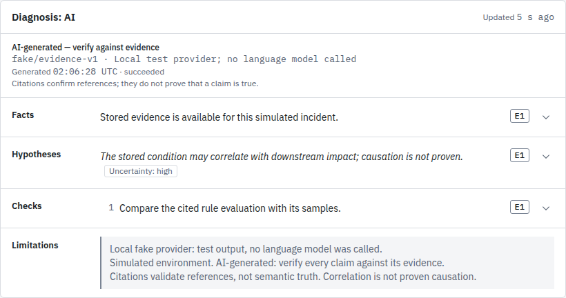
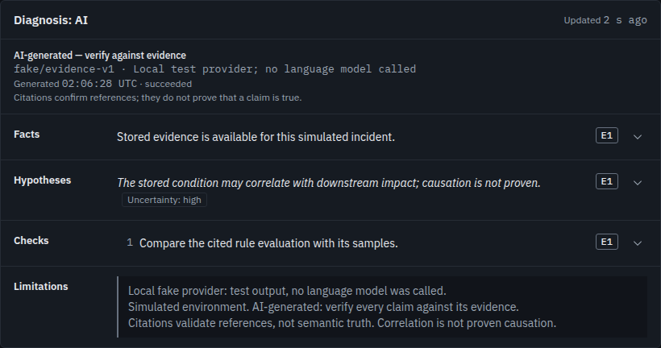

# Optional evidence-grounded diagnosis

`IPHI_LLM_PROVIDER=none` remains the default. The **Diagnose** action always builds a
reading from stored evidence without a model. **AI diagnosis** adds a separately labeled
result, clickable evidence, uncertainty, removed claims and a deterministic comparison from
the same evidence snapshot. A rejected response or provider failure shows that deterministic
fallback immediately; collection, health, incidents and `/ready` keep working independently.

To try the local **fake provider**, with no account, network request or cost:

```sh
IPHI_LLM_PROVIDER=fake docker compose up --build -d
```

Open an incident and choose **AI diagnosis**. The panel explicitly says that it is local test
output and no language model was called. Use **Compare with deterministic diagnosis** to
inspect the same observations through the deterministic reading.

| Local fake diagnosis, light theme | Same panel, dark theme |
|---|---|
|  |  |

For **free OpenRouter models**, put these settings in your ignored local `.env` and
supply your own `IPHI_LLM_API_KEY` there:

```dotenv
IPHI_LLM_PROVIDER=openrouter
IPHI_LLM_MODEL=particle-ai/particle-1:free
IPHI_LLM_REASONING_EFFORT=none
```

This model accepts reasoning effort `none`. For another model, restore
`IPHI_LLM_REASONING_EFFORT=default` or choose an effort it supports; mandatory-reasoning
models can spend the whole output budget before producing an answer. `openrouter/free`
automatically selects a free model, but capacity and structured-output support vary.
The adapter accepts only that free router or explicit `:free` variants, sets a zero
price ceiling, disables plugins, and rejects missing/nonzero reported usage cost. It
never switches to a paid route. Rate limits or unavailable free capacity show the
existing deterministic fallback. See [ADR 0024](adr/0024-openrouter-free-us08.md).

The separate OpenAI adapter uses `IPHI_LLM_PROVIDER=openai` and a configured model with
structured-output support; **live paid calls have not been tested**. Neither adapter
has a default paid model or bundled credential. The credential is passed only to the
API container. Free-provider data policies still apply: use simulated evidence only.

The server uses a fixed HTTPS endpoint, exposes no tools, and applies a shared deadline
(maximum 20 s, at most one retry), input/output caps and a persisted six-attempt/60 s actor
budget. Retried requests with the same `Idempotency-Key` reuse the stored result; conflicting
modes return 409, concurrent AI requests 409, and exhausted budget 429.

All provider input is bounded and redacted; rejected raw text and provider exception bodies
are not logged. The API exposes status, error code, token usage when available, latency and
`deterministic_id`, rather than the persisted prompt. Provider status describes its last
attempt, not a live availability probe. Citation validation establishes a reference, **not
factual truth or causation**. Pattern-based redaction cannot recognize every possible secret;
keep this demonstrator on simulated data. Configuration and limits:
[ADR 0021](adr/0021-diagnostic-llm-us08.md),
[diagnosis threat model](security/diagnostics-threat-model.md).
