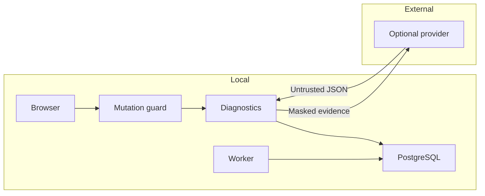

## Executive summary

The optional diagnosis path crosses two untrusted boundaries: stored observations into a model,
and model text into persisted results and the browser. Its highest risks are sensitive-data
disclosure and excessive provider work. Health evaluation and incident transitions remain
deterministic and never consume model output. Controls reduce these risks; neither schema
validation nor valid citation IDs establish that a model statement is true.

## Scope and assumptions

Scope: US-08 diagnosis routes, providers, evidence packing, persistence, monitor status and
incident UI. Context is supplied by AGENTS §§1/6, architecture §§06/07.1 and ADR 0007: one local
simulated platform, loopback-published ports, unauthenticated `dev-local` mutations before
US-11, no real OT access, no public deployment. These are approved project constraints rather
than inferred hosting assumptions. Owner approval covers this story. Auth/RBAC, reporting,
industrial connectors and generic repository hardening are outside this review.

OpenRouter extends this boundary under [ADR 0024](../adr/0024-openrouter-free-us08.md):
fixed HTTPS endpoint, free router or `:free` model allowlist, zero price ceiling, no
plugins, mandatory zero reported cost and trusted transport model identity. Schema,
citation, redaction, admission and deadline checks apply to both remote adapters.
Free-model capacity and retention policies depend on the selected provider; synthetic
live requests do not establish factual reliability. Account privacy controls have
not been changed. Public exposure or real sensitive telemetry would require a new
risk review before use.

## System model

### Primary components

React/Vite browser → FastAPI mutation guard → diagnostics service → PostgreSQL immutable
evidence/results; optional HTTPS provider. The worker independently evaluates health and
incidents. Compose runs API and worker from one backend image (`compose.yaml`, `app/main.py`).

### Data flows and trust boundaries

- Browser → API: incident UUID, mode and idempotency key over same-origin HTTP; loopback
  policy, JSON requirement, Fetch Metadata and Host checks; typed bounded transport schemas
  (`backend/app/api/mutations.py`, `backend/app/api/incidents.py`).
- PostgreSQL → evidence pack: stored metrics, rules and untrusted log text; bounded selection,
  redaction, JSON escaping and explicit data delimiters (`diagnostics/evidence.py`). No
  arbitrary log attributes are sent.
- API → provider: masked evidence and fixed instructions over verified HTTPS; server-only
  credential, fixed endpoint, redirects/proxy inheritance disabled, no tools, shared deadline,
  response/token bounds (`diagnostics/providers.py`).
- Provider → database/browser: JSON validated with strict extra-field and size constraints;
  labels resolved only against submitted evidence, unreferenced claims removed, output
  redacted; React renders text without HTML/Markdown execution (`diagnostics/validation.py`,
  `frontend/src/features/incidents/DiagnosisCard.tsx`).
- Diagnostic request → admission: dedicated session advisory locks and persisted actor budget;
  no incident row or transaction held across provider I/O (`diagnostics/repository.py`).

#### Diagram

## Assets and security objectives

| Asset | Why it matters | Security objective |
|---|---|---|
| Provider credential and recognizable PII | Must not reach frontend, prompts or logs | C |
| Stored evidence and diagnostic provenance | Operator must distinguish observation from hypothesis | I |
| Worker and incident lifecycle | Diagnosis must not stall or override supervision | I/A |
| Provider quota and API capacity | Expensive requests must be bounded | A |
| Published images and client contract | Build drift can bypass reviewed controls | I |

## Attacker model

### Capabilities

An attacker may control future connector log text or provider response content. A local process
can call the API; another website may try browser requests to localhost. The local operator can
configure a provider. Synthetic input remains untrusted despite its current simulated origin.

### Non-capabilities

The model cannot run tools, shell commands, OT writes or incident mutations. Remote access to
loopback and administrator control of the host, environment or database are not assumed.
No multi-tenant isolation claim is made before US-11.

## Entry points and attack surfaces

| Surface | How reached | Trust boundary | Notes | Evidence |
|---|---|---|---|---|
| POST diagnose | Same-origin/local HTTP | Browser/API | Guard, audit, mode/key bounds | `backend/app/api/incidents.py:diagnose_incident` |
| Log text | Stored incident evidence | DB/model | Untrusted and masked | `backend/app/diagnostics/evidence.py:build_pack` |
| Provider reply | HTTPS response | Model/API | Strict schema and citation mapping | `backend/app/diagnostics/validation.py:validate_reply` |
| Provider configuration | Server environment | Host/provider | API container only, no user URL | `compose.yaml`, `backend/app/core/settings.py` |
| Diagnostic rendering | Persisted API results | API/DOM | Escaped text and evidence chips | `frontend/src/features/incidents/DiagnosisPanel.tsx` |
| Dependencies/build | Locked packages and image builds | Build/runtime | CI audits and API drift check | `.github/workflows/ci.yml` |

## Top abuse paths

1. Inject instructions into a log → request diagnosis → attempt to make the model reveal data
   or recommend remediation. Data delimiters and no-tools reduce impact; instruction following
   is not provably prevented for a real model.
2. Return a plausible assertion with a nonexistent citation → make an unsupported claim appear
   sourced. Unknown labels are dropped and claims without retained citations are removed.
3. Cite a real evidence ID for a false assertion → mislead an operator. Reference checks cannot
   detect all semantic falsehoods; labeling, uncertainty and comparison remain necessary.
4. Send repeated or concurrent diagnosis requests → exhaust provider quota/API workers.
   Persistent budget, nonblocking admission, input/output caps and deadline bound the work.
5. Echo a secret in model text or error → disclose it through stored diagnostics or DOM.
   Pattern redaction applies before output persistence; raw rejected output and provider
   exception bodies are not exposed.
6. Hide optional provider failure as monitor failure → obscure actual supervision state.
   Provider status is reported separately and does not determine readiness.

## Threat model table

| Threat ID | Threat source | Prerequisites | Threat action | Impact | Impacted assets | Existing controls (evidence) | Gaps | Recommended mitigations | Detection ideas | Likelihood | Impact severity | Priority |
|---|---|---|---|---|---|---|---|---|---|---|---|---|
| TM-001 | Malicious log author | Log attached as evidence | Inject model instructions | Misleading investigation | Provenance | JSON boundary, fixed prompt, no tools (`evidence.py`, `providers.py`) | Real model may follow text | Keep human verification; review real telemetry before enabling | Removed claims, linked prompt | medium | medium | medium |
| TM-002 | Provider | Model reply accepted | Invent citations or causal facts | False confidence | Evidence integrity | Strict parser, mapping, common unsafe phrase removal (`validation.py`) | Real citation does not prove semantic support | Keep comparison and uncertainty visible | `validation.removed`, rejection code | medium | medium | medium |
| TM-003 | Sensitive input/provider echo | Recognizable secret enters text | Leak through provider or persistence | Disclosure | Credentials/PII | Redaction on input/output, attributes excluded, key only in API (`evidence.py`, `compose.yaml`) | Unknown secret formats may escape patterns | Require data review before non-synthetic use | Bounded redacted prompt audit | low | high | medium |
| TM-004 | Local caller | Mutation guard permits request | Repeated, concurrent or slow calls | Cost/capacity exhaustion | Quota, API availability | Persistent quota, advisory admission, global deadline (`repository.py`, `providers.py`) | Fixed-window boundary burst; crash before result can repeat provider work | Retain disabled default; never equate idempotency with exactly-once billing | Budget, latency, 409/429 audit | medium | medium | medium |
| TM-005 | Malicious website | User visits external page | Forge localhost mutation | Unwanted provider calls | Quota | JSON, Fetch Metadata, Host and loopback guard (`api/mutations.py`) | Local processes are trusted before US-11 | Keep local-only deployment; implement RBAC in US-11 | Denied audit events | low | medium | low |
| TM-006 | Dependency/build change | Unreviewed dependency or client drift | Alter runtime safeguards | Boundary compromise | Runtime/client integrity | Existing lockfiles, audits and API drift job (`ci.yml`) | Audits are not proof of absence of vulnerabilities | Review runtime promotion of httpx2 and preserve CI gates | CI audit/drift results | low | high | medium |

## Criticality calibration

Critical: hypothetical host credential compromise or arbitrary execution reaching real OT;
neither capability is provided by this story. High: provider key disclosure or a diagnosis path
that blocks health processing. Medium: misleading model content, bounded quota abuse, or
unknown-format sensitive text exposure. Low: rejected forged requests or non-sensitive
diagnostic metadata disclosure. Local simulated scope lowers exposure, not the potential
impact of disclosing a real provider credential.

## Focus paths for security review

| Path | Why it matters | Related Threat IDs |
|---|---|---|
| `backend/app/diagnostics/evidence.py` | Redaction, byte budget, untrusted logs | TM-001, TM-003 |
| `backend/app/diagnostics/validation.py` | Strict parsing, reference and claim removal | TM-002, TM-003 |
| `backend/app/diagnostics/providers.py` | Fixed HTTPS target, no tools, retry/deadline/bounds | TM-001, TM-004 |
| `backend/app/diagnostics/repository.py` | Persistent budget and lock ownership | TM-004 |
| `backend/app/diagnostics/service.py` | Commit before I/O, separate fallback, safe audit | TM-002, TM-004 |
| `backend/app/api/mutations.py` | Existing browser-forgery guard | TM-005 |
| `frontend/src/features/incidents/DiagnosisPanel.tsx` | Output labeling and comparison | TM-002 |
| `compose.yaml` | Credential isolation and local publication | TM-003, TM-005 |
| `.github/workflows/ci.yml` | Fake-provider coverage and inherited build gates | TM-006 |

## Notes on use

All discovered diagnosis entry points and boundaries are represented above. Runtime threats
are separate from the CI/build supply-chain boundary. Context comes from approved specs;
no additional hosting assumption was required. Unit fake-provider tests cannot establish
prompt-injection resistance or factual reliability of an untested real model. This review
does not claim production readiness or industrial certification.
