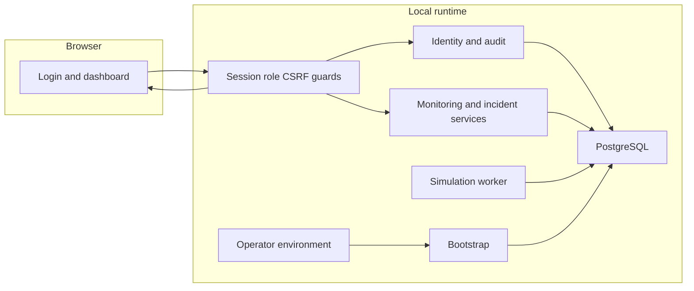

## Executive summary

US-11 replaces the local development mutation switch with persisted sessions,
server-enforced roles and CSRF checks. The main risks are credential/session theft,
unauthorized mutations, and login work exhausting a small local API. Controls and
negative tests address these paths; the feature remains a local simulated demonstrator.

## Scope and assumptions

Scope: identity, mutation/read guards, audit queries, SSE session checks, login UI,
CLI and credential bootstrap. The approved architecture §07.1 and ADRs 0007/0025
provide the deployment context: owner-operated, one simulated platform, loopback
HTTP locally, no real OT or public deployment. These are supplied requirements,
not new hosting assumptions. Existing diagnosis/report controls are unchanged.
Public internet hosting, multiple tenants, account recovery and an identity provider
are outside scope and would require a separate review. No unresolved hosting question
changes this local ranking; moving beyond loopback would change it materially.

## System model

### Primary components

React/Vite behind Nginx calls FastAPI; the identity module uses the same PostgreSQL
as the worker. Bootstrap initializes users from explicit environment secrets.
Evidence: `compose.yaml`, `backend/app/main.py:create_app`,
`backend/app/bootstrap.py`, `backend/app/identity/users.py:ensure_users`.

### Data flows and trust boundaries

- Browser → API: username/password at login; opaque cookie on operational reads;
  separate CSRF proof and JSON on mutations. Fetch Metadata, Host checks, bounded
  Pydantic input and no cross-origin preflight permission constrain browser forgery
  (`api/auth.py`, `api/mutations.py`, `api/request_policy.py`, `core/middleware.py`).
- API → PostgreSQL: parameter-bound queries read Argon2id hashes, hashed session
  secrets and current active/role state. Eight-hour expiry uses the injected wall
  clock; logout revokes the row (`identity/auth_service.py`, `auth_repository.py`).
- Environment → bootstrap: explicit operator passwords create or rotate demo users;
  rotation revokes sessions, never clears audit (`identity/users.py`). Local `.env`
  initialization preserves existing values and uses an atomic mode-600 file
  (`scripts/init_env.py`).
- API → browser: limited user DTO and CSRF proof; raw cookie remains HttpOnly,
  SameSite=Strict, Secure in production mode. Browser cache holds CSRF in memory and
  clears operational data on sign-out/rejection (`shared/identity/session.ts`).
- API → SSE: authenticated handshake and periodic session revalidation; no credentials
  in event URLs or payloads (`backend/app/api/events.py:events_stream`).
- Build/test → artifacts: lockfiles, API drift checks, dependency audits and secret
  scanning; disposable browser sessions are ignored (`.github/workflows/ci.yml`,
  `frontend/e2e/auth-setup.ts`, `.gitignore`). These are development controls, separate
  from runtime authorization.

#### Diagram

## Assets and security objectives

| Asset | Why it matters | Security objective |
|---|---|---|
| Passwords and session secrets | Permit access or impersonation | C |
| Simulation/incident mutations | Must require the approved role and actor | I |
| Audit records | Preserve allowed, failed and denied actions | I |
| Worker/API capacity | Login and optional diagnosis must not hide monitor failure | A |
| Environment/build artifacts | Must not disclose operator or provider credentials | C/I |

## Attacker model

### Capabilities

A local caller can send arbitrary HTTP input; a viewer can bypass disabled UI
controls; a hostile web page can attempt localhost requests; an attacker might
replay a stolen cookie or obtain a database copy. Log/comment text remains untrusted.

### Non-capabilities

Remote access to loopback, control of the owner account/environment, database writes,
or execution inside the containers is not assumed. Authorized host/database control
can defeat application identity and is not a boundary this story claims to enforce.
No real plant commands or model tools exist.

## Entry points and attack surfaces

| Surface | How reached | Trust boundary | Notes | Evidence |
|---|---|---|---|---|
| Login/logout/me | HTTP | Browser/API | Bounded credentials, opaque session, CSRF on logout | `api/auth.py` |
| Operational reads and SSE | HTTP/cookie | Browser/API | Valid active session required | `main.py`, `api/events.py` |
| Scenario/clock/incident changes | POST | Role/action | Engineer, admin reset, CSRF, audit | `api/mutations.py` |
| Audit list | GET | Admin/data | Bounded filters, time window, keyset cursor, DTO | `api/audit.py`, `identity/audit_queries.py` |
| Demo credentials | Files/environment | Operator/runtime | Explicit secrets, rotation/revocation | `scripts/init_env.py`, `identity/users.py` |
| CLI/browser setup | Local tools | Development/runtime | Real login, private ignored session files | `backend/scripts/client.py`, `frontend/e2e/auth-setup.ts` |

## Top abuse paths

1. Viewer crafts a scenario POST → tries to change platform state → server refuses
   and records actor/correlation despite disabled UI controls.
2. Malicious site forges login or mutation → tries login swapping or unwanted work
   → JSON/Fetch Metadata/Host checks and session-bound CSRF reject the request.
3. Stolen cookie is replayed → impersonation until expiry/revocation → hashed storage,
   HttpOnly/SameSite/Secure flags, logout, role/active rechecks and SSE revalidation
   limit exposure but cannot make an already stolen live cookie harmless.
4. Repeated/concurrent login guesses → password work or availability exhaustion →
   persisted per-user/global limits and nonblocking PostgreSQL admission bound hashing.
5. Operator secret enters tooling or artifacts → disclosure → init avoids printing
   secrets; CLI rejects non-loopback destinations/redirects/proxy inheritance; ignored
   session files and CI secret scanning reduce accidental publication.
6. User follows a crafted return URL or untrusted audit detail → redirect or script
   execution → same-origin return validation and React text rendering prevent these sinks.

## Threat model table

| Threat ID | Threat source | Prerequisites | Threat action | Impact | Impacted assets | Existing controls (evidence) | Gaps | Recommended mitigations | Detection ideas | Likelihood | Impact severity | Priority |
|---|---|---|---|---|---|---|---|---|---|---|---|---|
| TM-001 | Viewer/local caller | Local API reachability | Bypass UI role checks | Unauthorized state change | Mutation integrity | Server guards and role matrix (`mutations.py`, `test_identity.py`) | No tenant separation, by scope | Re-review each future route | Denied actor/correlation audit | low | high | medium |
| TM-002 | Hostile website | Owner visits the site | Forge login/mutation | Session swapping or unwanted work | Identity/actions | JSON, Fetch Metadata, restricted Host, Strict cookie, CSRF (`auth.py`, `request_policy.py`) | Local HTTP is not encrypted | Keep loopback; require HTTPS before wider exposure | Denied auth/mutation events | low | medium | low |
| TM-003 | Credential thief | Live cookie or DB copy | Replay session or crack password | Impersonation | Credentials/actions | Argon2id, random secrets hashed in DB, expiry/revocation/current role (`auth_service.py`) | A stolen live cookie works until revoked; local host is trusted | Protect host and environment; rotate compromised credentials | Auth audit and session revocation | low | high | medium |
| TM-004 | Local caller | Login reachability | Repeated/concurrent attempts | API work or shared lockout | Availability | Persistent 6/user and 20/global minute limit, advisory admission (`auth_service.py`) | Shared ceiling can deny legitimate login; refusal audits consume storage | Keep local-only scope; reassess capacity before public use | 429 and denied login events | medium | medium | medium |
| TM-005 | Artifact disclosure | Access to local/CI files | Read credentials or sessions | Impersonation or provider-key disclosure | Secrets/build | Mode600 atomic env, ignored browser files, no credential output, locked dependencies/audits/scanner (`init_env.py`, `ci.yml`) | Owner-readable env and failure traces are sensitive | Keep artifacts private; never attach session state to issues | Secret scan and review | low | high | medium |
| TM-006 | Crafted URL/text | User opens supplied link or audit detail | Redirect or DOM injection | Phishing/disclosure | Browser/session | Origin-checked return URL, escaped React text (`session.ts`, `AuditPage.tsx`) | Same-origin XSS elsewhere could use the session | Preserve CSP and safe text sinks | Return-URL and audit-text tests | low | high | medium |

## Criticality calibration

Critical would mean arbitrary host execution or access to real OT; neither exists
in this feature. High impact includes admin impersonation or credential disclosure.
Medium includes unauthorized simulated mutations, bounded login denial or misleading
audit data. Low includes rejected forgery or non-sensitive schema visibility.
Loopback exposure lowers likelihood; it does not reduce the impact of stealing a
real provider credential. Public hosting or sensitive telemetry changes this ranking.

## Focus paths for security review

| Path | Why it matters | Related Threat IDs |
|---|---|---|
| `backend/app/identity/auth_service.py` | Login admission, expiry and revocation | TM-003, TM-004 |
| `backend/app/api/auth.py` | Cookie issuance and audited logout/forgery | TM-002, TM-003 |
| `backend/app/api/mutations.py` | Server roles and CSRF before state change | TM-001, TM-002 |
| `backend/app/identity/passwords.py` | Argon2 and safe constant-time proof comparison | TM-002, TM-003 |
| `backend/app/api/events.py` | Existing stream cannot outlive invalidated session indefinitely | TM-003 |
| `scripts/init_env.py` | Credential preservation and file protection | TM-005 |
| `frontend/src/shared/identity/session.ts` | Session cache and safe return URL | TM-003, TM-006 |
| `frontend/src/features/identity/` | Login, role menu and escaped audit rendering | TM-001, TM-006 |
| `.github/workflows/ci.yml` | Independent build/test/secret boundary | TM-005 |

## Notes on use

The review covers login/logout/me, operational reads, SSE, mutations, audit and
bootstrap, with each discovered boundary represented above. Runtime and build/test
risks are separated. Context is the approved local simulation scope, not a claim of
production readiness. Review fixes include safe rejection of non-ASCII CSRF input,
audited anonymous logout refusal, audit domain DTOs and explicit POST form semantics.
Tests and runtime evidence are recorded in the backlog only after execution.
